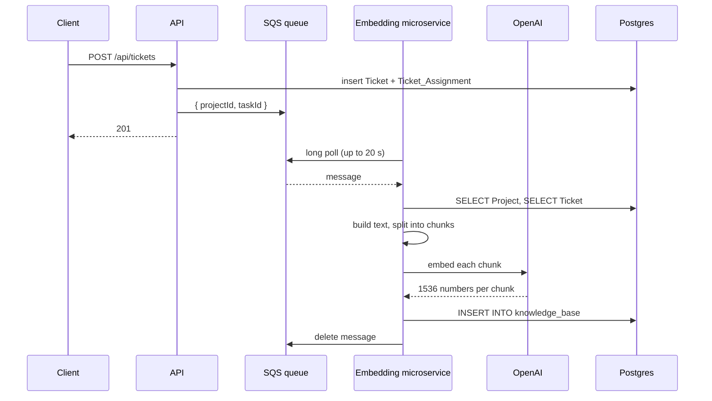

# 01 – Embedding

[← Back to the notes index](../README.md)

How a project or ticket becomes vectors in the `knowledge_base` table. This is
the "write" half of the AI feature; the "read" half is
[02 – Asking questions](02-asking-questions.md).

Two services share one Postgres database and one SQS queue:

| Service | Role | Code |
|---|---|---|
| `cognify-ops-api` (this repo) | Decides **when** to embed; sends a message | [`queues/publishers/embeddingPublisher.ts`](../../src/queues/publishers/embeddingPublisher.ts) |
| `embedding-microservice` | Does the embedding; writes `knowledge_base` | `embedding-microservice/src/consumers`, `src/services` |

---

## 1. What an embedding is

An embedding is a list of numbers (here 1536 of them) that stands for the
meaning of a piece of text. Texts with similar meaning get lists that are close
together. That lets the database answer "which stored texts are about the same
thing as this question?" without matching exact words.

## 2. The picture



The API does not wait for the embedding. A new ticket can be asked about a few
seconds after it is created, not instantly.

## 3. When the API sends a message

| Event | Message | Also |
|---|---|---|
| Project created | `{ projectId, taskId: null }` | |
| Ticket created | `{ projectId, taskId }` | |
| Ticket edited (`PATCH /tickets/:id`) | `{ projectId, taskId }` | Deletes the ticket's old `knowledge_base` rows first |
| Ticket deleted | none | Deletes the ticket's `knowledge_base` rows |
| Project edited, status changed, assignee changed | none | |

The message body is JSON with exactly two fields:

```json
{ "projectId": 1, "taskId": 7 }
```

It carries IDs only. The microservice reads the current text from the database
itself, so a message never holds stale content.

Queue settings come from the environment: `SQS_QUEUE_URL`, `AWS_REGION`, and
`SQS_ENDPOINT` for local ElasticMQ only. On the server, credentials come from
the EC2 instance role.

## 4. What the microservice does with a message

1. **Receive.** Long-polls the queue: up to 5 messages, waiting up to 20 s.
2. **Fetch the rows** with raw SQL: `SELECT * FROM "Project"` and, when
   `taskId` is set, `SELECT * FROM "Ticket"`.
3. **Build the text.** From each row only the keys `name`, `title`,
   `description`, `status` are used, when present and not empty
   (`utils/jsonTotext.ts`). In practice that is **name and description**: the
   tables have no `title` or `status` column.

   ```
   Project Details:
   name: Website. description: Relaunch

   Task Details:
   name: Fix login page. description: Button does nothing on mobile
   ```

   A project message (`taskId: null`) has only the first block. A ticket
   message has both, so each ticket chunk also carries its project's name.
4. **Chunk.** `RecursiveCharacterTextSplitter`, 500 characters per chunk with
   100 characters of overlap. Most tickets are one chunk.
5. **Embed.** One OpenAI call per chunk, model `text-embedding-3-small`
   (`EMBEDDING_MODEL`), 1536 dimensions. A rate limiter allows at most 5 calls
   at once and one new call every 110 ms.
6. **Store.** One bulk `INSERT` into `knowledge_base`:

   | Column | Value |
   |---|---|
   | `id` | generated UUID |
   | `task_id` | the ticket ID, or `NULL` for a project message |
   | `project_id` | the project ID |
   | `chunk_index` | 0, 1, 2… |
   | `chunk_text` | the chunk |
   | `embedding` | the vector, sent as the text `[0.01,-0.02,…]` |
   | `metadata` | `{}` (default) |

7. **Delete the message** from the queue.

**If anything fails**, the message is not deleted. SQS shows it again after the
visibility timeout, and after the queue's maximum receive count it moves to the
dead-letter queue (both set in the Terraform `queue` module).

## 5. Things to know

- **Only name and description are embedded.** Priority, type, due date, status
  and assignee are not in the text, so the AI cannot answer "what is overdue?"
  or "what is assigned to Sam?". To fix it, change `keysToInclude` or build the
  text from a joined query.
- **Project chunks are never refreshed or removed.** Editing a project sends no
  message, and nothing deletes rows where `task_id IS NULL`. The ticket chunks
  also contain the project name as it was when the ticket was embedded.
- **No foreign keys on `knowledge_base`.** Deleting a project in the database
  leaves its chunks behind. Only the ticket delete and edit paths clean up.
- **Edit can race.** The API deletes old chunks, then queues the job. If two
  edits happen quickly, both jobs insert, and the ticket has two sets of chunks
  (same current text, so answers stay right, but rows are duplicated). The same
  happens if a message is delivered twice. A safer design is for the
  microservice to delete the ticket's chunks in the same transaction as the
  insert.
- **A queue failure fails the create request.** On create, an SQS error returns
  `500` although the project or ticket was saved, and no embedding will be
  made for it. On edit the error is only logged.
- **No vector index.** Search compares against every row. Fine for thousands of
  chunks; add an HNSW index on `embedding` when the table grows.
- The microservice also has `POST /api/generate-embedding`
  (`{ projectId, taskId }`) to embed by hand. It has no authentication and is
  meant to stay private inside the Compose network.
- Changing `EMBEDDING_MODEL` to one with a different size breaks inserts (the
  column is `vector(1536)`), and vectors from different models cannot be
  compared. A model change means re-embedding everything.
