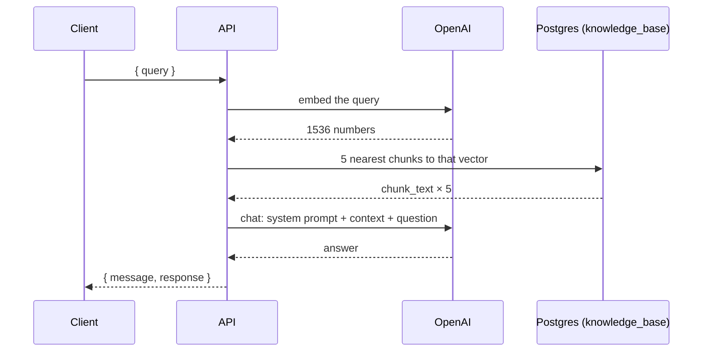

# 02 – Asking questions

[← Back to the notes index](../README.md)

How the API answers a question using the stored embeddings. This pattern is
called RAG (retrieval-augmented generation): **retrieve** the most relevant
stored text, then let the chat model **generate** an answer from it.

Code: [`routes/intellecta/openaiRoutes.ts`](../../src/routes/intellecta/openaiRoutes.ts),
[`services/openAI/getQueryResponse.ts`](../../src/services/openAI/getQueryResponse.ts),
[`services/openAI/vectorstores.ts`](../../src/services/openAI/vectorstores.ts),
[`controllers/intellecta/openaiController.ts`](../../src/controllers/intellecta/openaiController.ts)

---

## 1. Two endpoints

| Endpoint | Uses project data | Response |
|---|---|---|
| `POST /api/openai/askintellecta` | **Yes** (RAG) | One JSON object when the answer is complete |
| `POST /api/openai/chat` | No, plain chat model | Streamed (server-sent events) |

Both need a token.

## 2. `askintellecta` — answer from project data

```http
POST /api/openai/askintellecta

{ "query": "What is the login bug about?" }
```

```json
{ "message": "Coginify Response", "response": "The login bug is…" }
```



Steps:

1. **Open the vector store.** LangChain's `PGVectorStore` is pointed at the
   `knowledge_base` table: `id` is the ID column, `embedding` the vector
   column, `chunk_text` the content column.
2. **Embed the question** with the same model used for the stored chunks
   (`text-embedding-3-small`). It has to be the same model, or the numbers are
   not comparable.
3. **Similarity search.** `similaritySearch(query, 5)` returns the 5 chunks
   whose vectors are nearest to the question's (cosine distance, LangChain's
   default).
4. **Build the prompt.** The 5 `chunk_text` values are joined with newlines:

   ```
   system: You are a helpful project management assistant.
   user:   Use the following context to answer the user's question.

           Context:
           <chunk 1>
           <chunk 2>
           …

           Question:
           <query>
   ```

5. **Ask the chat model.** `OPENAI_CHAT_MODEL` (default `gpt-4o`), temperature
   0.7. The model is called in streaming mode, but the API collects the whole
   answer and sends it once; the client does not see it arrive word by word.

Errors: empty `query` → `400`; anything else → `500` with
`{ "error": "...", "details": "..." }`.

## 3. `chat` — plain streaming chat

```http
POST /api/openai/chat

{ "question": "Write a ticket description for a login bug" }
```

Sends the question straight to the chat model, with **no** project context and
no system prompt, and streams the answer as server-sent events:

```
data: {"type":"message","data":"Sure"}
data: {"type":"message","data":", here"}
…
data: {"type":"final","data":"<whole answer, tidied>"}
data: {"type":"end"}
```

The `final` event is the full text after a small clean-up
(`manuallyPolishText`): capitalize sentence starts, fix two fixed typos, and
collapse all whitespace — which also removes line breaks, so lists and
paragraphs in `final` end up on one line. On an error mid-stream:
`data: {"type":"error","error":"Streaming failed."}`.

## 4. Environment

| Variable | Used for |
|---|---|
| `OPENAI_API_KEY` | Both endpoints |
| `OPENAI_CHAT_MODEL` | Chat model, default `gpt-4o` |
| `EMBEDDING_MODEL` | Query embedding, default `text-embedding-3-small`. Must match the microservice. |
| `DATABASE_URL` | Vector store connection |

## 5. Things to know

- **Search is not limited to a project or a user.** The 5 nearest chunks come
  from the whole table, so a question can be answered with text from a project
  the user is not a member of. `knowledge_base.project_id` is stored and ready
  to filter on; the query just needs to pass it (and check membership).
- **The model only knows names and descriptions.** Status, priority, due date
  and assignee are not embedded (see [01 – Embedding](01-embedding.md)).
  Questions like "how many tickets are open?" cannot be answered correctly —
  and with only 5 chunks of context, neither can any question that needs to
  count or list everything.
- **No relevance cut-off.** The 5 nearest chunks are used even when none is
  really related; the prompt does not tell the model to say "I don't know".
- **No conversation memory.** Each request is answered on its own.
- **A new connection pool per question.** `initVectorStore()` runs on every
  request: it opens a new Postgres pool, runs
  `CREATE EXTENSION IF NOT EXISTS vector` and `CREATE TABLE IF NOT EXISTS`, and
  the pool is never closed. Under load this can use up database connections.
  Fix: create the store once and reuse it.
- **Empty query still runs.** The `400` for a missing `query` is sent without a
  `return`, so the handler continues and then fails trying to send a second
  response.
- **The same code exists twice.** `embedding-microservice` has its own
  `POST /api/askIntellecta` with an identical service. The frontend goes
  through this API's version; the microservice's copy is unused and has no
  authentication.
- The user's text goes into the prompt as-is. The model could be talked into
  ignoring the context, but it has no tools and no write access, so the worst
  case is a wrong or off-topic answer.
