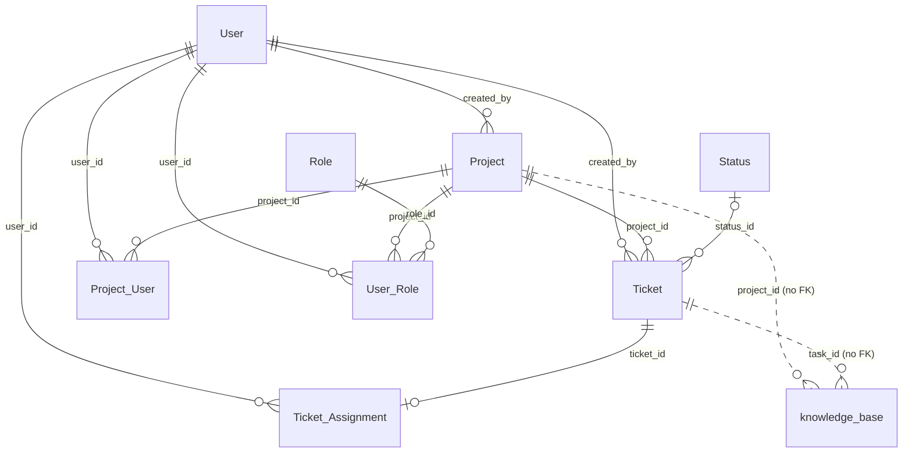

# 01 – Tables and relations

[← Back to the notes index](../README.md)

Every table, every column, and how the tables point at each other. Source of
truth: [`prisma/schema.prisma`](../../prisma/schema.prisma) and the SQL in
[`prisma/migrations`](../../prisma/migrations).

Database: PostgreSQL with the `pgvector` extension. Table and column names are
case-sensitive in SQL, so raw queries need quotes: `SELECT * FROM "Ticket"`.

---

## 1. The picture

In words:

- A **User** creates **Projects** and **Tickets**.
- A **Project** has many **Tickets**.
- Users and Projects are many-to-many, recorded **twice**: `Project_User`
  (membership) and `User_Role` (membership + which role).
- A **Ticket** has zero or one **Status** and zero or one assignee
  (`Ticket_Assignment`).
- **knowledge_base** holds the AI text chunks. It stores project and ticket IDs
  but has no foreign keys.

## 2. Tables

`PK` = primary key, `FK` = foreign key. "Default" is what the database fills in
when the column is not given.

### User

| Column | Type | Null | Default | Notes |
|---|---|---|---|---|
| `user_id` | text | no | – | **PK**. A UUID made by the API at sign up. |
| `email` | text | yes | – | **Unique**. Stored trimmed and lower-cased. |
| `password_hash` | text | yes | – | `scrypt$<salt hex>$<hash hex>` |
| `full_name` | text | yes | – | |
| `picture` | text | yes | – | URL |
| `last_login` | timestamp | yes | – | Set on each sign in. |
| `created_at` | timestamp | no | `now()` | |

### Project

| Column | Type | Null | Default | Notes |
|---|---|---|---|---|
| `project_id` | serial int | no | auto | **PK** |
| `name` | text | no | – | |
| `description` | text | yes | – | |
| `project_key` | text | no | – | Short code such as `COG`. Not unique. |
| `created_by` | text | no | – | **FK → User.user_id**, on delete cascade |
| `created_at` | timestamp | no | `now()` | |
| `updated_at` | timestamp | no | – | Set by Prisma on every update. |

### Ticket

| Column | Type | Null | Default | Notes |
|---|---|---|---|---|
| `ticket_id` | serial int | no | auto | **PK** |
| `project_id` | int | no | – | **FK → Project.project_id**, on delete cascade. Indexed. |
| `name` | text | no | – | |
| `description` | text | yes | – | |
| `created_by` | text | no | – | **FK → User.user_id**, on delete cascade |
| `status_id` | int | yes | – | **FK → Status.status_id**, on delete set null |
| `priority` | enum `TicketPriority` | no | `medium` | `low`, `medium`, `high`, `urgent` |
| `type` | enum `TicketType` | no | `task` | `task`, `bug`, `story` |
| `due_date` | timestamp | yes | – | |
| `created_at` | timestamp | no | `now()` | |
| `updated_at` | timestamp | no | – | Set by Prisma on every update. |

The priority enum is declared lowest to highest, so `ORDER BY priority` sorts by
urgency.

### Status

| Column | Type | Null | Default | Notes |
|---|---|---|---|---|
| `status_id` | serial int | no | auto | **PK** |
| `name` | text | no | – | **Unique** |
| `created_at` | timestamp | no | `now()` | |
| `updated_at` | timestamp | no | – | |

Seeded rows: `To Do`, `In Progress`, `Done`.

### Role

| Column | Type | Null | Default | Notes |
|---|---|---|---|---|
| `role_id` | serial int | no | auto | **PK** |
| `role_name` | text | no | – | **Unique** |
| `created_at` | timestamp | no | `now()` | |
| `updated_at` | timestamp | no | – | |

Seeded rows: `admin`, `default`.

### Project_User — who is in which project

| Column | Type | Null | Default | Notes |
|---|---|---|---|---|
| `project_id` | int | no | – | **PK part**, **FK → Project.project_id**, cascade |
| `user_id` | text | no | – | **PK part**, **FK → User.user_id**, cascade. Indexed. |
| `joined_at` | timestamp | no | `now()` | |
| `updated_at` | timestamp | no | – | |

Primary key `(project_id, user_id)`: a user is in a project at most once.

### User_Role — which role a user has in which project

| Column | Type | Null | Default | Notes |
|---|---|---|---|---|
| `user_id` | text | no | – | **PK part**, **FK → User.user_id**, cascade |
| `role_id` | int | no | – | **PK part**, **FK → Role.role_id**, cascade. Indexed. |
| `project_id` | int | no | – | **PK part**, **FK → Project.project_id**, cascade. Indexed. |
| `created_at` | timestamp | no | `now()` | |
| `updated_at` | timestamp | no | – | |

Primary key `(user_id, role_id, project_id)`. Because `role_id` is part of the
key, the database allows one user to hold several roles in the same project.
The code prevents it by checking before it inserts.

### Ticket_Assignment — who a ticket is assigned to

| Column | Type | Null | Default | Notes |
|---|---|---|---|---|
| `ticket_id` | int | no | – | **PK**, **FK → Ticket.ticket_id**, cascade |
| `user_id` | text | no | – | **FK → User.user_id**, cascade. Indexed. |

`ticket_id` alone is the primary key, so **a ticket has at most one assignee**.

### knowledge_base — the vector store

| Column | Type | Null | Default | Notes |
|---|---|---|---|---|
| `id` | uuid | no | `gen_random_uuid()` | **PK** |
| `task_id` | int | yes | – | The ticket ID. `NULL` for a chunk that describes only a project. **No FK.** |
| `project_id` | int | yes | – | **No FK.** |
| `chunk_index` | int | yes | – | Position of the chunk in its text, from 0. |
| `chunk_text` | text | yes | – | The text that was embedded. |
| `metadata` | jsonb | yes | `{}` | Not written by our code; LangChain expects the column. |
| `embedding` | vector(1536) | yes | – | From `text-embedding-3-small`. |
| `created_at` | timestamp | no | `now()` | |

Written by the embedding microservice with raw SQL, read through LangChain.
Prisma cannot read the `embedding` column (`Unsupported`), but can delete rows.
There is no index on `embedding`, so a search scans the whole table. See
[AI – Embedding](../ai/01-embedding.md).

## 3. What a delete takes with it

| Delete a… | Also removed | Left behind |
|---|---|---|
| **User** | Projects they created (and everything under those), Tickets they created, their `Project_User`, `User_Role` and `Ticket_Assignment` rows | `knowledge_base` chunks |
| **Project** | Its Tickets, their assignments, its `Project_User` and `User_Role` rows | `knowledge_base` chunks |
| **Ticket** | Its `Ticket_Assignment` row | `knowledge_base` chunks — the API removes them itself in `deleteTicketService` |
| **Status** | Nothing. Tickets keep existing with `status_id = NULL` | |
| **Role** | Every `User_Role` row with that role | The `Project_User` rows, so the users stay members without a role |

Note the first row: deleting a user deletes the projects they created **for
everyone**, and every ticket they created in any project. Tickets that were
only assigned to them stay, without an assignee.

## 4. Things to know

- **Membership lives in two tables.** Creating a project or adding a user
  writes both `Project_User` and `User_Role` in one transaction. Reads use
  `User_Role` (`GET /projects/:userId`, `GET /projects/:projectId/users`).
  If the two ever disagree, `User_Role` is what the API shows.
- **`role_id = 3` is hard-coded** when adding a user to a project
  ([`projectRepository.ts`](../../src/repositories/project/projectRepository.ts)),
  but the seed creates only two roles (`admin` = 1, `default` = 2 on a fresh
  database). On a fresh database adding a member fails on the foreign key until
  a role with ID 3 exists.
- `updated_at` has no database default. Prisma fills it; a raw SQL insert must
  set it.
- `Ticket.created_by` and `Project.created_by` are not checked against the
  signed-in user (see [Authentication – Present implementation](../authentication/03-present-implementation.md)).

## 5. Migrations, in order

| Migration | What it did |
|---|---|
| `20250407100055_init` | `Role`, `User_Role`, `Project`, `Ticket`, `User` (only `user_id`), `Project_User`, `Status` |
| `20250410131956_add_project_key_column` | `Project.project_key` |
| `20250503120305_add_ticket_assignment` | `Ticket_Assignment` |
| `20261114000000_add_knowledge_base_and_seed` | `vector` extension, `knowledge_base`, seed roles and statuses |
| `20261114010000_local_auth` | `User.email`, `password_hash`, `full_name`, `picture`, `last_login`, `created_at` |
| `20261114020000_add_ticket_priority_type_due_date` | `Ticket.priority`, `type`, `due_date`, index on `Ticket.project_id` |

Changing the schema: edit `schema.prisma`, then
`npx prisma migrate dev --name <name>` locally and `npx prisma migrate deploy`
on the server.
