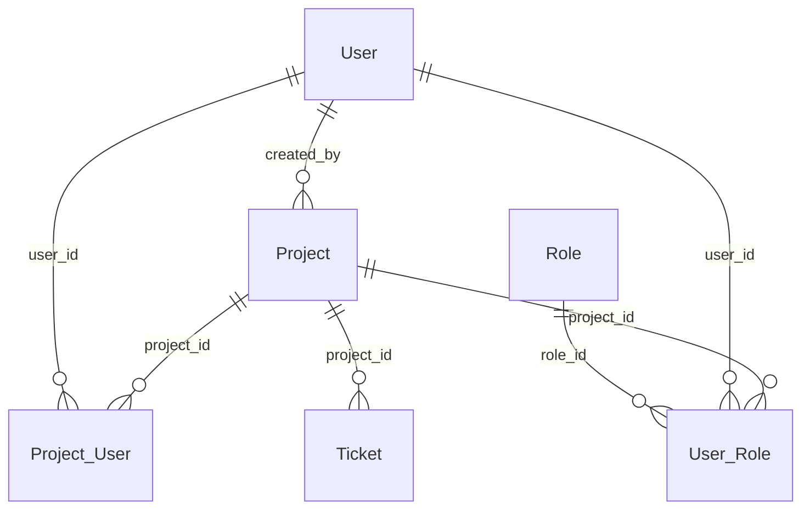

# 01 – Projects

[← Back to the notes index](../README.md)

How projects and project membership work: the tables with their exact fields,
the endpoints, and what each one writes.

Code: [`projectRoutes.ts`](../../src/routes/projects/projectRoutes.ts) →
[`projectController.ts`](../../src/controllers/projects/projectController.ts) →
[`projectService.ts`](../../src/services/project/projectService.ts) →
[`projectRepository.ts`](../../src/repositories/project/projectRepository.ts)

All routes need a token.

---

## 1. Tables involved



**Project**

| Field | Type | Required | Notes |
|---|---|---|---|
| `project_id` | int | auto | Primary key |
| `name` | text | yes | |
| `description` | text | no | |
| `project_key` | text | yes | Short code, e.g. `COG`. Not unique. |
| `created_by` | text | yes | → `User.user_id` |
| `created_at` | timestamp | auto | |
| `updated_at` | timestamp | auto | |

**Project_User** (membership): `project_id`, `user_id` (together the primary
key), `joined_at`, `updated_at`.

**User_Role** (role per project): `user_id`, `role_id`, `project_id` (together
the primary key), `created_at`, `updated_at`.

**Role**: `role_id`, `role_name` (unique), `created_at`, `updated_at`. Seeded
with `admin` and `default`.

Full column details and delete rules: [Database – Tables and relations](../database/01-relations.md).

## 2. Endpoints

| Method and path | Does |
|---|---|
| `POST /api/projects` | Create a project; the creator becomes its admin |
| `GET /api/projects` | Every project in the database |
| `GET /api/projects/:userId` | Projects the given user belongs to, each with that user's `role_id` |
| `PATCH /api/projects/:projectId` | Change `name`, `description`, `project_key` |
| `GET /api/projects/users/available` | Every user in the system (for the "add member" picker) |
| `POST /api/projects/:projectId/user` | Add one user to the project |
| `POST /api/projects/:projectId/users` | Add several users to the project |
| `GET /api/projects/:projectId/users` | Members of the project, each with their `role_id` |
| `GET /api/roles` | All roles |

## 3. Create a project

```http
POST /api/projects

{ "name": "Website", "description": "Relaunch", "project_key": "WEB", "user_id": "3f0c…-uuid" }
```

Validation (`express-validator`): `name`, `user_id` and `project_key` are
required strings; `description` is an optional string. Failure → `400` with
`{ "errors": [...] }`.

Steps:

1. Look up the ID of the role named `admin`.
2. In **one transaction**:
   1. insert the `Project` row with `created_by = user_id`
   2. insert `User_Role (user_id, admin role, project_id)`
   3. insert `Project_User (project_id, user_id)`

   If any insert fails, all three are rolled back.
3. Put a message on the SQS queue: `{ "projectId": <id>, "taskId": null }`.
   The embedding microservice turns the project's name and description into
   vectors (see [AI – Embedding](../ai/01-embedding.md)).
4. Return `201` with the `Project` row.

If step 3 fails (queue unreachable), the response is `500` **but the project
already exists** — the transaction finished before the message was sent.

## 4. List projects

- `GET /api/projects` → `prisma.project.findMany()`. No filter: every project,
  for any signed-in user.
- `GET /api/projects/:userId` → reads the user's `User_Role` rows, loads those
  projects, and returns each project with a `role_id` field added. A user with
  no roles gets `[]`.

## 5. Update a project

`PATCH /api/projects/:projectId` with any of `name`, `description`,
`project_key`. Returns the updated row. A non-numeric ID → `400`; an ID that
does not exist → `500`.

The body is passed to Prisma as-is, with no validator. An unknown field makes
Prisma throw (→ 500). Updating a project does **not** refresh its embedding, so
AI answers keep using the old name and description.

## 6. Members

**Add one** — `POST /api/projects/:projectId/user` with `{ "userId": "…" }`

1. If the user already has a `User_Role` row for this project → `409`
   `"User already assigned role in this project"`.
2. If the user already has a `Project_User` row → `409`
   `"User already added to this project"`.
3. Otherwise insert both rows in one transaction → `201`
   `"User successfully added to project"`.

**Add several** — `POST /api/projects/:projectId/users` with
`{ "userIdList": ["…", "…"] }`

Users already in the project are skipped, the rest are inserted with
`createMany` in one transaction. Always `200`:

```json
{
  "totalRequested": 3,
  "addedCount": 2,
  "skippedCount": 1,
  "details": [
    { "userId": "a", "status": false, "reason": "User already assigned role or added to project" },
    { "userId": "b", "status": true,  "reason": "User successfully added to project" }
  ]
}
```

**List** — `GET /api/projects/:projectId/users` reads `User_Role` for the
project, loads those users' profiles, and returns each profile with `role_id`.

## 7. Things to know

- **New members get `role_id = 3`, hard-coded** in both add endpoints. The seed
  only creates `admin` and `default` (IDs 1 and 2 on a fresh database), so
  adding a member fails with a foreign-key error until role 3 exists. Fix:
  look up the `default` role by name, as create-project does for `admin`.
- **No permission checks.** Any signed-in user can add anyone to any project
  and rename any project. `User_Role` is recorded but not enforced.
- **`user_id` comes from the request body** on create, not from the token.
- There is no endpoint to delete a project, remove a member, or change a
  member's role.
- `project_key` is not unique; two projects can share a key.
- `GET /api/projects/:userId` and `PATCH /api/projects/:projectId` share the
  `/:something` shape. They do not clash because the methods differ, but
  `GET /api/projects/users/available` only works because it is declared first.
- In the add endpoints, the `400` for bad input is sent without a `return`, so
  the handler carries on and tries the insert anyway.
