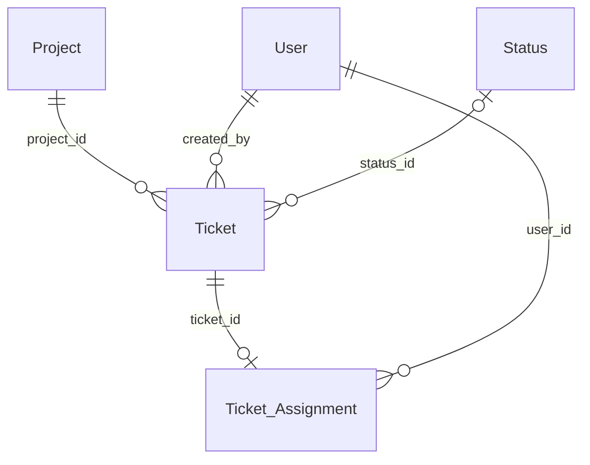

# 01 – Tasks (tickets)

[← Back to the notes index](../README.md)

A task is a `Ticket` row. This note covers the tables with their exact fields,
the endpoints, and what each one writes.

Code: [`ticketRoutes.ts`](../../src/routes/tickets/ticketRoutes.ts) →
[`ticketController.ts`](../../src/controllers/ticket/ticketController.ts) →
[`ticketService.ts`](../../src/services/ticket/ticketService.ts) →
[`ticketRepository.ts`](../../src/repositories/ticket/ticketRepository.ts).
Validation: [`ticketValidator.ts`](../../src/middleware/ticket/ticketValidator.ts).
Types: [`types/ticket.ts`](../../src/types/ticket.ts).

All routes need a token.

---

## 1. Tables involved



**Ticket**

| Field | Type | Required | Default | Notes |
|---|---|---|---|---|
| `ticket_id` | int | auto | | Primary key |
| `project_id` | int | yes | | → `Project.project_id` |
| `name` | text | yes | | |
| `description` | text | no | | |
| `created_by` | text | yes | | → `User.user_id` |
| `status_id` | int | no | `NULL` | → `Status.status_id` |
| `priority` | enum | no | `medium` | `low` \| `medium` \| `high` \| `urgent` |
| `type` | enum | no | `task` | `task` \| `bug` \| `story` |
| `due_date` | timestamp | no | `NULL` | |
| `created_at` | timestamp | auto | | |
| `updated_at` | timestamp | auto | | |

**Ticket_Assignment**: `ticket_id` (primary key, → `Ticket`), `user_id`
(→ `User`). One row per ticket, so one assignee per ticket.

**Status**: `status_id`, `name` (unique), `created_at`, `updated_at`. Seeded
with `To Do`, `In Progress`, `Done`. Listed by `GET /api/status`.

Full column details and delete rules: [Database – Tables and relations](../database/01-relations.md).

## 2. Endpoints

| Method and path | Does |
|---|---|
| `POST /api/tickets` | Create a ticket and assign it |
| `GET /api/tickets` | Every ticket in the database |
| `GET /api/tickets/project/:projectId` | Tickets of one project, with filter, search and sort |
| `GET /api/tickets/:ticketId` | One ticket |
| `PATCH /api/tickets/:ticketId` | Edit name, description, priority, type, due date |
| `PATCH /api/tickets/:ticketId/assign` | Change the assignee |
| `PATCH /api/tickets/:ticketId/status` | Change the status |
| `DELETE /api/tickets/:ticketId` | Delete the ticket |
| `GET /api/status` | All statuses |

## 3. Create

```http
POST /api/tickets

{
  "userId": "assignee-uuid",
  "ticketData": {
    "project_id": 1,
    "name": "Fix login page",
    "description": "Button does nothing on mobile",
    "created_by": "creator-uuid",
    "status_id": 1,
    "priority": "high",
    "type": "bug",
    "due_date": "2026-12-01"
  }
}
```

`userId` is the **assignee**; `ticketData.created_by` is the creator.

Validation: `userId`, `ticketData.name`, `ticketData.project_id` (integer) and
`ticketData.created_by` are required. `description`, `status_id`, `priority`,
`type`, `due_date` (ISO 8601 or `null`) are optional. Failure → `400` with
`{ "errors": [...] }`.

Steps:

1. Check the assignee exists → else `404`.
2. In **one transaction**: insert the `Ticket`, then insert
   `Ticket_Assignment (ticket_id, userId)`. Only the known columns are written,
   whatever else the client sent.
3. Put `{ "projectId": <project_id>, "taskId": <ticket_id> }` on the SQS queue
   so the ticket gets embedded (see [AI – Embedding](../ai/01-embedding.md)).
4. Return `201`:
   `{ "message": "Ticket created and assigned successfully.", "data": { "ticket": {…}, "assignment": {…} } }`

If step 3 fails, the response is `500` **but the ticket already exists**.
A `project_id`, `created_by` or `status_id` that does not exist fails on the
foreign key and also comes back as `500`.

## 4. Read

- `GET /api/tickets` → all tickets, no filter, without assignee.
- `GET /api/tickets/:ticketId` → `{ "data": {…} }`, `404` if missing, without
  assignee.
- `GET /api/tickets/project/:projectId` → `{ "data": [...] }`, each ticket with
  its `Ticket_Assignment` array (zero or one item).

Query options for the project list:

| Query | Meaning |
|---|---|
| `status=2` | Only this `status_id` |
| `assignee=<user_id>` | Only tickets assigned to this user |
| `priority=high` | Only this priority |
| `type=bug` | Only this type |
| `q=login` | Case-insensitive search in `name` and `description` |
| `sort=` | `created_at` (default), `updated_at`, `due_date`, `priority`, `name` |
| `order=` | `asc` (default) or `desc` |

Filters combine with AND. When sorting by `due_date`, tickets without one
always come last. Equal values are ordered by `ticket_id`. An invalid value →
`400`.

## 5. Edit

`PATCH /api/tickets/:ticketId` with at least one of `name`, `description`,
`priority`, `type`, `due_date`.

- Fields left out are not touched.
- `description: null` and `due_date: null` clear the value.
- `name` is trimmed and may not be empty.
- Unknown ticket → `404`.

After the update the API **refreshes the embedding**: it deletes the ticket's
`knowledge_base` rows and queues a new embedding job. If that part fails it is
only logged; the edit is already saved and the response is still `200`.

Response: `{ "message": "Ticket 7 updated successfully.", "data": {…ticket with Ticket_Assignment…} }`

## 6. Assign and change status

**Assign** — `PATCH /api/tickets/:ticketId/assign` with `{ "userId": "…" }`.
Checks the ticket and the user exist (`404` otherwise), then updates the
`Ticket_Assignment` row. If the ticket has no assignment row → `404`
`"No assignment found for ticket N"`; the endpoint changes an assignee, it
cannot add the first one.

**Status** — `PATCH /api/tickets/:ticketId/status` with `{ "statusId": 2 }`.
`statusId` must be a JSON number, not a string (`400` otherwise). Returns the
updated ticket.

Neither change is re-embedded, and neither needs to be: the embedded text holds
only the name and description.

## 7. Delete

`DELETE /api/tickets/:ticketId` → `404` if missing. Deletes the `Ticket`; the
database removes its `Ticket_Assignment` (cascade). The API then deletes the
ticket's `knowledge_base` rows itself, because that table has no foreign key.
A failure there is logged and the response is still `200`.

## 8. Things to know

- **No permission checks.** Any signed-in user can read, edit, reassign and
  delete any ticket in any project.
- **`created_by` comes from the request body**, not from the token.
- Nothing checks that the assignee is a member of the ticket's project.
- A missing ticket or status on the status endpoint answers `500`, not `404`:
  the repository catches its own `404` and rethrows it as a generic error.
- `GET /api/tickets` and `GET /api/tickets/:ticketId` do not include the
  assignee; only the project list does.
- There is no pagination on any list.
